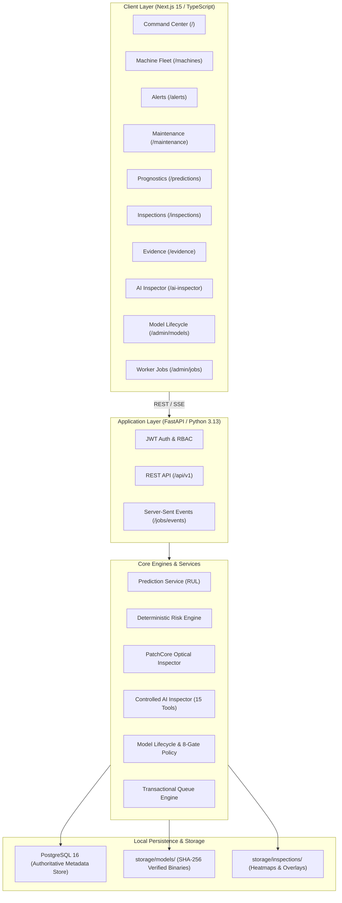

# MachIntel — Multimodal AI for Predictive Maintenance & Industrial Inspection

[](#project-roadmap--milestones)
[](LICENSE)
[](https://www.python.org/)
[](https://www.postgresql.org/)
[](https://fastapi.tiangolo.com/)
[](https://nextjs.org/)
[](#testing--verification)

**MachIntel** is an enterprise-grade industrial machine-health intelligence and optical inspection platform. Designed for reliability engineers, maintenance leads, and quality-control inspectors, MachIntel transforms raw multi-channel machine telemetry and optical inspection imagery into actionable, evidence-backed operational intelligence.

> **Local-Only Architecture:** MachIntel is engineered exclusively for local on-premises and containerized execution (`docker compose`). In accordance with project requirements, **cloud deployment is explicitly out of scope**.

---

## 1. The Industrial Problem
Modern industrial plants suffer from two distinct failure modes:
1. **Unplanned Downtime from Internal Machine Wear**: Rotating machinery (turbofans, compressors, gearboxes) degrades progressively over hundreds of operating cycles. Traditional threshold alerting fires only after critical failure modes have begun, resulting in catastrophic downtime or premature replacement.
2. **Defects Escaping Optical Quality Control**: Structural surface flaws (scratches, cracks, bends, orientation faults) escape human visual inspection, leading to downstream assembly failures and expensive recall campaigns.
3. **The Multi-Modal Fraud Trap**: Existing commercial solutions often claim "multimodal AI" by fabricating unvetted correlations between disparate datasets (e.g. attempting to link unrelated vibration telemetry with fastener photographs). MachIntel categorically rejects this, enforcing strict physical domain separation while synthesizing intelligence at an auditable **Evidence Layer**.

---

## 2. What the System Does
MachIntel operates as a **human-in-the-loop industrial intelligence and decision-support system**:
- **Causal RUL Prognostics**: Predicts Remaining Useful Life ($RUL^*$) and computes normalized Health Index ($HI \in [0.0, 1.0]$) across run-to-failure assets using causal temporal feature windows ($W=20$).
- **Optical Surface Inspection**: Performs unsupervised visual anomaly detection and pixel-level defect localization using frozen deep patch embeddings (PatchCore WideResNet-50-2) and calibrated statistical thresholds ($\tau = 2.8155$).
- **Deterministic Risk Engine**: Translates continuous prognostic output into explicit, non-sensational operational states (`NORMAL`, `WATCH`, `ELEVATED`, `CRITICAL`) with scoped deduplication.
- **Evidence Layer & Provenance**: Tracks end-to-end cryptographic lineage linking sensor windows, model versions, risk assessments, alerts, and maintenance work orders.
- **Controlled AI Inspector**: An evidence-grounded forensic investigation assistant with 15 read-only tools, zero actuator access, zero direct SQL, and mandatory citation validation.
- **Local Model Lifecycle**: PostgreSQL model registry with SHA-256 integrity verification, immutable evaluation manifests, and deterministic 8-gate promotion.
- **ACID Background Workers**: Transactional background job processing using PostgreSQL row-level locks (`SELECT FOR UPDATE SKIP LOCKED`) without Redis or Celery.

---

## 3. Two Independent Evidence Verticals

```
+─────────────────────────────────────────────────────────────────────────────+
|                        MACHINTEL EVIDENCE SYNTHESIS                         |
+─────────────────────────────────────────────────────────────────────────────+
         ▲                                                           ▲
         │ Strictly Segregated                                       │ Strictly Segregated
         │ Domain Lineage                                            │ Domain Lineage
+─────────────────────────────────+         +─────────────────────────────────+
|   VERTICAL 1: MACHINE HEALTH    |         |  VERTICAL 2: VISUAL INSPECTION  |
|   NASA C-MAPSS (FD001)          |         |  MVTec AD (metal_nut)           |
|                                 |         |                                 |
|  - 100 Run-to-Failure Turbofans |         |  - 335 Lossless Optical Images  |
|  - 100 Censored Test Turbofans  |         |  - 220 Normal Reference Images  |
|  - 33,727 Verified Cycle Rows   |         |  - 115 Benchmark Test Captures  |
|  - 17 Active Sensor Channels    |         |  - 93 Ground-Truth Defect Masks |
|  - 102 Rolling Causal Features  |         |  - PatchCore WideResNet-50-2    |
|  - Piecewise Linear RUL Target  |         |  - Statistical 3-Sigma Threshold|
|  - Random Forest & Ridge Models |         |  - Pixel Defect Heatmaps (Jet)  |
+─────────────────────────────────+         +─────────────────────────────────+
```

---

## 4. Architecture Overview

MachIntel is organized as a clean local-first monorepo:



---

## 5. Machine Learning Workflow (C-MAPSS RUL)
1. **Raw Telemetry**: Ingests NASA C-MAPSS FD001 cycle telemetry across 21 sensors and 3 operational settings. Drops 7 invariant channels ($\sigma=0$).
2. **Causal Feature Extraction**: Computes rolling statistics (mean, std, min, max, slope) over window $W=20$ strictly using past cycles. Generates 102 engineered features.
3. **Preprocessing**: Normalizes features using `RobustScaler` fitted strictly on `INTERNAL_TRAIN` (Units 1–80).
4. **Target Formulation**: Piecewise-linear degradation target $RUL^* = \min(125, T_{fail} - t)$.
5. **Models**: Evaluates Ridge regression and Random Forest ($n=100$, depth=12).
6. **Selection**: Random Forest selected based on lowest internal validation RMSE (19.5411).
7. **Health Index**: $HI = \text{clamp}(RUL / 125, 0, 1)$.

---

## 6. Computer Vision Workflow (MVTec AD PatchCore)
1. **Backbone**: Frozen `Wide_ResNet50_2` pre-trained on ImageNet.
2. **Patch Embeddings**: Extracts mid- and high-level representations from `layer2` (512d) and `layer3` (1024d) with $3 \times 3$ local neighborhood aggregation (1536d patch space, 784 patches per $700 \times 700$ image).
3. **Coreset Reduction**: Subsamples normal training patches to 5% coreset ($8,624$ patch vectors, seed 42) for fast $\approx 38\text{ ms}$ inference on CPU.
4. **Statistical Calibration**: Calibrates decision threshold strictly on the 220 normal training images ($\mu=2.4895, \sigma=0.1087 \rightarrow \tau = \mu + 3\sigma = 2.8155$).
5. **Localization**: Generates $28 \times 28$ patch anomaly distances, upsamples via bilinear interpolation, applies Gaussian smoothing ($\sigma=4$), and renders Jet overlays.

---

## 7. Risk Intelligence & Deterministic Alerting
Operational states are derived deterministically from the authoritative Health Index ($HI \in [0.0, 1.0]$):
- $HI \ge 0.70 \rightarrow \textbf{NORMAL}$ (Nominal operation, no alert).
- $0.40 \le HI < 0.70 \rightarrow \textbf{WATCH}$ (Minor trend deviation, `INFO` alert).
- $0.15 \le HI < 0.40 \rightarrow \textbf{ELEVATED}$ (Active wear, `WARNING` alert).
- $HI < 0.15 \rightarrow \textbf{CRITICAL}$ (Severe degradation, `CRITICAL` alert).
- **Scoped Deduplication**: Scoped key `{machine_id}:{risk_state}:{policy_version}` suppresses redundant alerts while an existing alert is active (`OPEN` or `ACKNOWLEDGED`).

---

## 8. Evidence Layer Architecture
- Standardized `EvidenceRecord` and `EvidenceRelationship` tables in PostgreSQL.
- Captures source record references, timestamps, model versions, and artifact digests.
- **Strict Domain Isolation**: Cross-domain relationships between NASA C-MAPSS and MVTec AD are rejected by policy (`CrossDomainEvidenceException` HTTP 422).

---

## 9. Maintenance Workflow (Decision Support)
- **Policy `maintenance-policy-v1.0.0`**: Automatically drafts work orders based on risk state or inspection defect findings.
- **Strict Non-Autonomous Policy**: Does not trigger equipment shutdowns or issue SCADA/PLC commands without mandatory human review.
- **Finite-State Machine**: `OPEN` $\rightarrow$ `ACKNOWLEDGED` $\rightarrow$ `IN_PROGRESS` $\rightarrow$ `COMPLETED` (or `CANCELLED`).
- **Closed-Loop Audit**: Records `MAINTENANCE_RECOMMENDATION` and `MAINTENANCE_OUTCOME` evidence records.

---

## 10. Controlled AI Inspector
- **Read-Only**: Zero actuator access, zero physical equipment mutation, zero raw SQL execution.
- **15 Parameterized Tools**: Strictly typed tools querying existing application services.
- **Security Defenses**: Rejects SQL keywords, path traversal (`../`), and command injection.
- **Grounding Verification**: Responses cite verified `evidence_id` tokens; unverified claims are stripped.
- **Audit Logging**: Every prompt, tool execution trace, citation, and latency metric is stored in `ai_investigations`.

---

## 11. Model Lifecycle & Registry
- **Authoritative PostgreSQL Registry**: Tracks `domain`, `model_family`, `version`, `status`, `artifact_sha256`, and reproducibility manifests.
- **Cryptographic SHA-256 Verification**: Verifies local artifact integrity before loading for inference and on administrative demand.
- **Deterministic 8-Gate Promotion**:
  1. `GATE_1_ARTIFACT_EXISTS`
  2. `GATE_2_CHECKSUM_VALID`
  3. `GATE_3_DATASET_VALID`
  4. `GATE_4_FEATURE_CONFIG_VALID`
  5. `GATE_5_EVALUATION_MANIFEST_EXISTS`
  6. `GATE_6_REQUIRED_METRICS_PRESENT`
  7. `GATE_7_EVALUATION_PASSED`
  8. `GATE_8_DOMAIN_ROLE_CONSISTENT`
- Exactly one active promoted model per domain. Active models resolve through the registry.

---

## 12. Background Worker & Realtime Infrastructure
- **ACID Queue**: PostgreSQL `background_jobs` table using row-level exclusion locks (`SELECT ... FOR UPDATE SKIP LOCKED`).
- **Job Types**: `EVIDENCE_REFRESH`, `RISK_REFRESH`, `MAINTENANCE_RECOMMENDATION_REFRESH`, `ANALYTICS_REFRESH`, `MODEL_INTEGRITY_CHECK`.
- **Reliability**: Worker daemon with async signal trapping (`SIGINT`, `SIGTERM`), periodic scheduler, heartbeat registry, and stale lease recovery.
- **Realtime Observability**: Server-Sent Events (SSE) stream (`/api/v1/jobs/events`) with typed event schemas.

---

## 13. Verified Benchmark Metrics

### RUL Machine Health (NASA C-MAPSS FD001)
- **Active Model**: `rul-randomforest-v1.0.0`
- **Validation RMSE**: `19.5411`
- **Official Test RMSE**: `19.0187`
- **Validation PHM Score**: `60,056.0`
- **Official Test PHM Score**: `1,306.8`
- **Candidate Model**: `rul-ridge-v1.0.0` (Validation RMSE 21.2868, Test RMSE 18.5714 — preserved RF selection based on validation performance).

### Visual Anomaly Detection (MVTec AD metal_nut)
- **Active Model**: `mvtec-patchcore-metalnut-v1.0.0`
- **Image ROC-AUC**: `0.9858`
- **PR-AUC**: `0.9967`
- **F1-Score**: `0.9613`
- **Precision**: `0.9886`
- **Recall**: `0.9355`
- **Pixel ROC-AUC**: `0.9769`
- **Calibrated Threshold**: $\tau = 2.8155$ (3-sigma on 220 normal reference captures)

---

## 14. Technology Stack

| Layer | Technology | Rationale |
|---|---|---|
| **Backend Framework** | FastAPI (Python 3.13) | High-performance asynchronous REST API, OpenAPI auto-documentation, Pydantic V2 data validation. |
| **Database** | PostgreSQL 16 | ACID transactions, row-level queue locking (`SKIP LOCKED`), relational integrity, JSONB support. |
| **ORM & Migrations** | SQLAlchemy 2.0 / Alembic | Explicit schema versioning with deterministic migration heads. |
| **Machine Learning** | scikit-learn / NumPy / Joblib | Reproducible tabular feature extraction and regression modeling. |
| **Computer Vision** | PyTorch / Torchvision | Deep patch embedding extraction via WideResNet-50-2 and tensor manipulation. |
| **Frontend Framework** | Next.js 15 (App Router) / React 19 | Server-side rendering, static optimization, TypeScript type safety. |
| **Icons & Styling** | Lucide React / Vanilla CSS | Industrial telemetry aesthetics, zero bloated CSS runtime, full accessibility control. |
| **Testing** | Pytest / Vitest / jsdom | Comprehensive unit, integration, and security verification. |

---

## 15. Local Setup & Quickstart

### Prerequisites
- Python 3.11+ (Python 3.13 tested)
- Node.js 18+ (Node 22 tested)
- PostgreSQL 16 running on `localhost:5432`

### 1. Configure Environment
```bash
cp .env.example .env
```

### 2. Backend Setup
```bash
# Set up Python virtual environment
python3 -m venv backend/.venv
source backend/.venv/bin/activate

# Install dependencies
pip install -r backend/requirements.txt

# Run migrations
cd backend && alembic upgrade head && cd ..

# Bootstrap admin account
ADMIN_EMAIL="admin@machintel.io" ADMIN_USERNAME="admin" ADMIN_PASSWORD="<choose-a-strong-password>" python3 backend/scripts/create_first_admin.py

# Seed verified models & compute SHA-256 checksums
python3 -c "from backend.app.db.session import SessionLocal; from backend.app.services.model_lifecycle_service import ModelLifecycleService; db=SessionLocal(); ModelLifecycleService.seed_verified_models(db); db.close()"

# Start API server
uvicorn backend.app.main:app --host 0.0.0.0 --port 8000 --reload
```

### 3. Frontend Setup
```bash
cd frontend
npm install
npm run dev
```

Navigate to [http://localhost:3000](http://localhost:3000) and log in with `admin` / `AdminPassword2026!`.

---

## 16. Testing & Verification

### Backend Test Suite (Pytest)
```bash
backend/.venv/bin/pytest backend/tests/ -v
```
**Result: 179 / 179 PASSED** across 19 test suites.

### Frontend Test Suite (Vitest)
```bash
cd frontend && npm test -- --run
```
**Result: 62 / 62 PASSED** across 14 test suites.

### TypeScript Compilation & Build
```bash
cd frontend
npx tsc --noEmit
npm run build
```
**Result: 0 errors**, 16 static/dynamic routes compiled cleanly.

---

## 17. Operational Demo Walkthrough (10 Minutes)
A complete 15-step reviewer walkthrough script is documented in [`docs/demo/DEMO_WALKTHROUGH.md`](docs/demo/DEMO_WALKTHROUGH.md):
1. **Login** (`/login`)
2. **Command Center Overview** (`/`)
3. **Machine Fleet Navigation** (`/machines`)
4. **Sensor Telemetry Stream** (`/machines/TURBOFAN-ENG-001`)
5. **Prognostics & Estimated RUL** (`/predictions`)
6. **Risk Evaluation & Alert Triage** (`/alerts`)
7. **Evidence Lineage Tracing** (`/evidence`)
8. **Maintenance Work Orders** (`/maintenance`)
9. **Optical Visual Inspection** (`/inspections`)
10. **Defect Localization Heatmaps** (`/inspections`)
11. **Domain Isolation Verification** (`/evidence`)
12. **AI Inspector Investigation** (`/ai-inspector`)
13. **Tool Execution Trace & Citations** (`/ai-inspector`)
14. **Model Lifecycle & 8-Gate Policy** (`/admin/models`)
15. **Background Jobs & Worker Health** (`/admin/jobs`)

---

## 18. Project Roadmap & Milestones

- [x] **M0: Product & Dataset Validation** *(Approved)*
- [x] **M1: Application Skeleton** *(Approved)*
- [x] **M2: Real Data Foundation** *(Approved)*
- [x] **M3: Machine Analytics** *(Approved)*
- [x] **M4: First ML Vertical Slice (C-MAPSS RUL)** *(Approved)*
- [x] **M5: Prediction History, Risk Engine & Alerts** *(Approved)*
- [x] **M6: Computer Vision Vertical Slice (MVTec AD PatchCore)** *(Approved)*
- [x] **M7: Inspection Analytics** *(Approved)*
- [x] **M8: Evidence Intelligence** *(Approved)*
- [x] **M9: Maintenance Workflow & Work Orders** *(Approved)*
- [x] **M10: Controlled AI Inspector** *(Approved)*
- [x] **M11: Hardening, Security, Reliability & Production Readiness** *(Approved)*
- [x] **M12: Background Workers & Realtime Infrastructure** *(Approved)*
- [x] **M13: Local Production Packaging & Deployment** *(Approved)*
- [x] **M14: MLOps & Model Lifecycle** *(Approved)*
- [x] **M15: Polish, Documentation & Demo** *(Complete)*
- [ ] **M16: Final Independent Verification** *(Pending)*

---

## 19. Project Structure

```
MachIntel/
├── backend/
│   ├── alembic/                 # Database migrations (Head: a1b2c3d4e5f6)
│   ├── app/
│   │   ├── api/v1/              # Authenticated REST endpoints
│   │   ├── core/                # Config, logging, security, error handlers
│   │   ├── ml/                  # ML metrics, RUL dataset, feature pipeline
│   │   ├── models/              # SQLAlchemy models (Registry, Risk, Jobs, etc.)
│   │   ├── schemas/             # Pydantic V2 schemas
│   │   ├── services/            # Core business logic & engines
│   │   └── worker/              # Worker daemon, handlers, scheduler
│   ├── scripts/                 # Ingestion, training, evaluation, admin bootstrap
│   └── tests/                   # 19 Pytest test suites (179 tests)
├── frontend/
│   ├── app/                     # Next.js 15 pages (App Router)
│   ├── components/              # Technical UI components & layouts
│   ├── lib/                     # API client, auth context, utilities
│   ├── types/                   # TypeScript interfaces
│   └── __tests__/               # 14 Vitest test suites (62 tests)
├── docs/                        # Comprehensive technical documentation
│   ├── architecture/            # System architecture & Mermaid diagrams
│   ├── demo/                    # 10-minute demo walkthrough script
│   ├── mlops/                   # Model registry, 8 promotion gates, manifests
│   ├── ai-inspector/            # AI Inspector safety & tools
│   ├── cv/                      # Computer vision & PatchCore
│   ├── ml/                      # RUL regression & feature engineering
│   ├── workers/                 # Worker daemon & ACID queue
│   └── deployment/              # Local Docker Compose & packaging
├── storage/
│   ├── models/                  # SHA-256 verified local model artifacts
│   └── inspections/             # Defect localization heatmaps & overlays
├── data/raw/                    # NASA C-MAPSS FD001 & MVTec AD datasets
├── docker-compose.yml           # Local production container stack
├── Makefile                     # Operational commands
└── README.md                    # Project documentation
```

---

## 20. System Limitations & Safety Boundaries

1. **Local-First On-Premises**: MachIntel does not use cloud platforms, Kubernetes, or managed registries.
2. **Decision Support Only**: Does not directly control equipment or issue autonomous actuator/PLC commands.
3. **Non-Sensational RUL**: RUL is an empirical estimate, not a guaranteed failure timestamp.
4. **Strict Domain Segregation**: C-MAPSS and MVTec AD are completely separate industrial domains; no multimodal cross-coupling exists.
5. **No Online Retraining**: Retraining workflows are explicit, offline, and human-in-the-loop.
6. **No Fabricated Drift**: Monitoring reflects observed operational telemetry.

---

## 21. Dataset Provenance & Licenses

1. **NASA C-MAPSS Turbofan Degradation Dataset**:
   - Provider: NASA Prognostics Center of Excellence (PCoE), NASA Ames Research Center.
   - Authors: Amar Saxena, Kai Goebel (2008).
   - License: NASA Open Data Policy (Public Domain).
2. **MVTec Anomaly Detection (MVTec AD) Dataset**:
   - Provider: MVTec Software GmbH, Munich, Germany.
   - Authors: Paul Bergmann, Michael Fauser, David Sattlegger, Carsten Steger (CVPR 2019 / IJCV 2021).
   - License: Creative Commons Attribution-NonCommercial-ShareAlike 4.0 International (CC BY-NC-SA 4.0).

---

## 22. License
MachIntel is licensed under the **Apache License 2.0**. See [`LICENSE`](LICENSE) for details.
