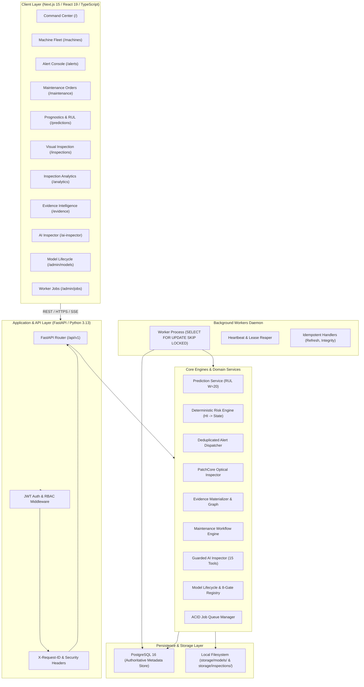
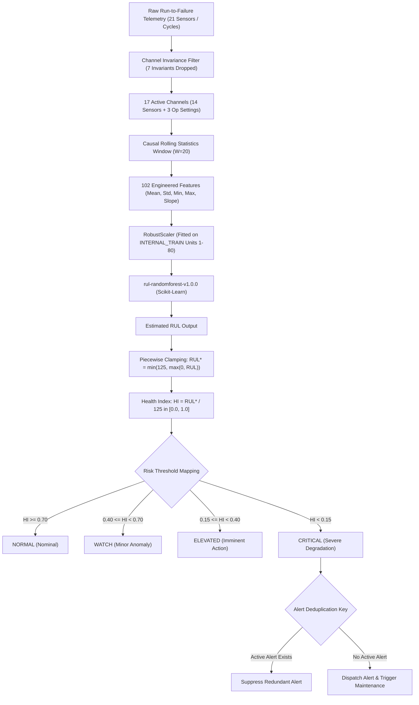
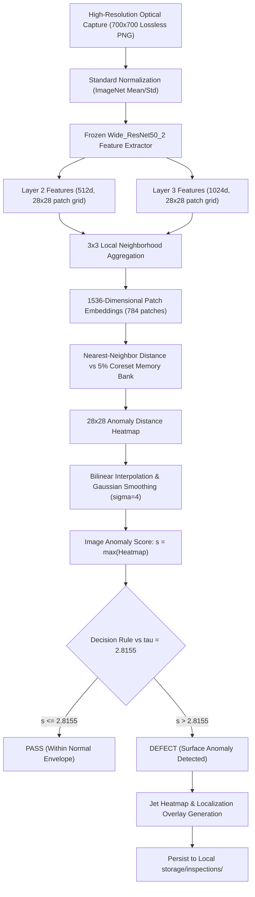
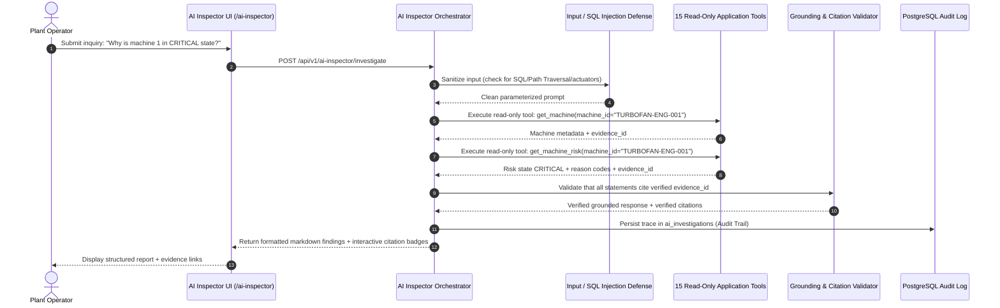
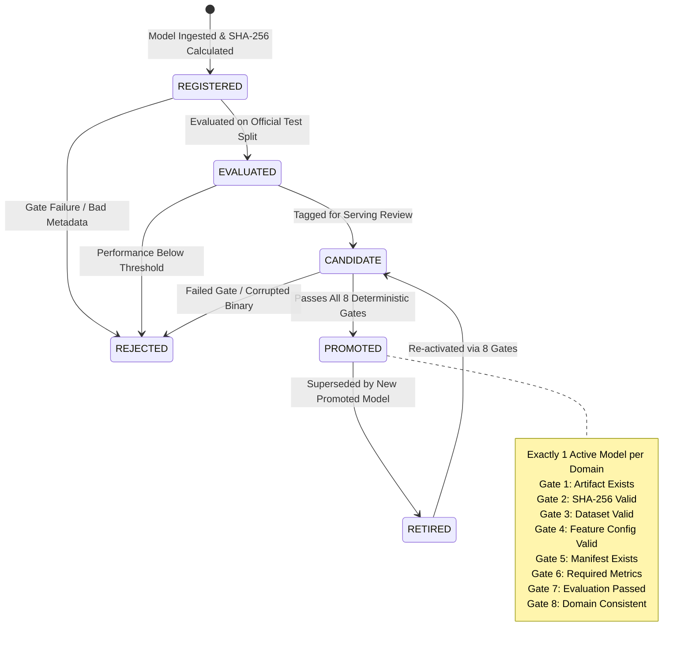
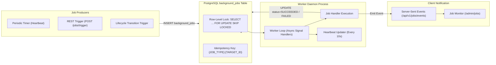

# MachIntel Technical Architecture Specification

## 1. System Overview & Monorepo Topology

MachIntel is an enterprise-grade industrial machine-health intelligence and optical inspection platform. Engineered exclusively for **local on-premises and containerized execution**, it eliminates external cloud platforms, cloud ML services, and unvetted shadow pipelines.



---

## 2. Machine Health Prognostic Pipeline (NASA C-MAPSS FD001)

The Machine Health vertical models progressive high-pressure compressor degradation across turbofan engines.



---

## 3. Optical Visual Inspection Pipeline (MVTec AD metal_nut)

The Visual Inspection vertical performs unsupervised optical surface defect detection and pixel-level localization.



---

## 4. Evidence Lineage & Strict Domain Isolation

MachIntel categorically prohibits unvetted multimodal coupling.

```mermaid
graph TD
    subgraph MachineHealthDomain ["Domain 1: MACHINE_HEALTH (NASA C-MAPSS)"]
        E_Tele["Evidence: TELEMETRY (Sensor Cycles)"]
        E_Pred["Evidence: RUL_PREDICTION (Estimated RUL)"]
        E_HI["Evidence: HEALTH_INDEX (Normalized Score)"]
        E_Risk["Evidence: RISK_ASSESSMENT (State Evaluation)"]
        E_Alert["Evidence: ALERT (Deduplicated Incident)"]
        E_MaintMH["Evidence: MAINTENANCE_RECOMMENDATION (Engine Work Order)"]

        E_Tele -->|DERIVED_FROM| E_Pred
        E_Pred -->|EVALUATED_BY| E_HI
        E_HI -->|TRIGGERS| E_Risk
        E_Risk -->|EMITS| E_Alert
        E_Risk -->|RECOMMENDS| E_MaintMH
    end

    subgraph VisualInspectionDomain ["Domain 2: VISUAL_INSPECTION (MVTec AD)"]
        E_Img["Evidence: IMAGE (Optical Capture)"]
        E_Score["Evidence: ANOMALY_SCORE (Distance Metric)"]
        E_Heat["Evidence: LOCALIZATION (Pixel Anomaly Map)"]
        E_Dec["Evidence: INSPECTION_DECISION (PASS / DEFECT)"]
        E_MaintCV["Evidence: MAINTENANCE_RECOMMENDATION (Nut Work Order)"]

        E_Img -->|DERIVED_FROM| E_Score
        E_Score -->|LOCALIZED_BY| E_Heat
        E_Score -->|EVALUATED_BY| E_Dec
        E_Dec -->|RECOMMENDS| E_MaintCV
    end

    MachineHealthDomain -.->|REJECTED: CrossDomainEvidenceException (HTTP 422)| VisualInspectionDomain
```

---

## 5. Controlled AI Inspector Investigation Flow

The AI Inspector is an evidence-grounded decision-support forensic assistant.



---

## 6. Model Lifecycle & Deterministic Promotion Gates

Models progress through an explicit state machine with cryptographic integrity gates.



---

## 7. Background Worker & ACID Job Architecture

Background jobs execute deterministically via PostgreSQL transactional queues without Redis or Celery.


