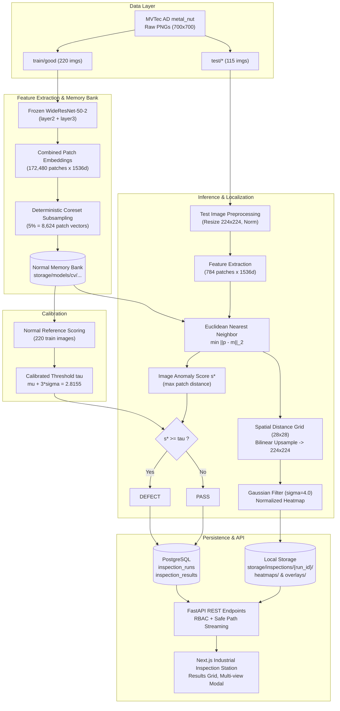

# Computer Vision Pipeline Architecture & Domain Separation

## 1. Domain Separation Principle

MachIntel explicitly maintains clean architectural separation between its two foundational datasets:

```
+-------------------------------------------------------------------+
|                            MACHINTEL                              |
+---------------------------------+---------------------------------+
|   MACHINE HEALTH INTELLIGENCE   |  VISUAL INSPECTION INTELLIGENCE |
|  (Prognostics & Diagnostics)    |  (Optical Quality Control)      |
+---------------------------------+---------------------------------+
| • NASA C-MAPSS (FD001)          | • MVTec AD (metal_nut)          |
| • Run-to-failure run telemetry  | • High-res surface inspection   |
| • RUL regression & Health Index | • Frozen PatchCore detector     |
| • Deterministic Alert lifecycle | • Image anomaly score & heatmap |
| • Serial: TURBOFAN-ENG-XXX      | • Run/Batch: Fastener Inspection|
+---------------------------------+---------------------------------+
```

> **Critical Rule**: C-MAPSS turbofan engines and MVTec metal nuts share NO physical identity or temporal coupling. Visual inspection results are tracked independently under `inspection_runs` and `inspection_results`, preventing false multimodal claims.

---

## 2. End-to-End Visual Inspection Workflow



---

## 3. Storage Hierarchy & Artifact Segregation

- **Database (PostgreSQL)**:
  - `inspection_runs`: Tracks run ID, dataset identifier, category, model version, feature configuration version, policy version, calibrated threshold, total/passed/defect counts, and summary evaluation metrics JSON.
  - `inspection_results`: Stores individual image evaluation records, source filename, image-level score, model decision (`PASS`/`DEFECT`), benchmark ground truth (`PASS`/`DEFECT`), and local relative artifact paths.
- **Local Filesystem Object Storage**:
  - `storage/models/cv/mvtec-patchcore-metalnut-v1.0.0/`: Persists memory bank tensor (`memory_bank.pt`) and configuration metadata (`config.json`).
  - `storage/inspections/{run_id}/`: Stores generated colormapped anomaly heatmaps, visual overlays, and evaluation summary JSON.
